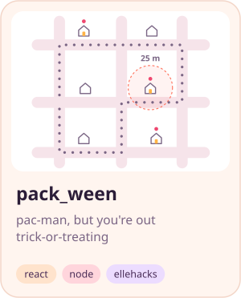
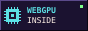
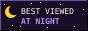

  

  
  
  

i'm a cs student at waterloo building things where software, machine learning and ethics meet. i like ml you can actually poke at, so most of my projects end with a heatmap somewhere.

lately i've been getting models to run right in the browser: no server, no uploads, just your gpu doing its thing.

### 📟 a little about me

- **cs** @ [university of waterloo](https://uwaterloo.ca/), mostly self-taught and very project-driven
- co-created **[ethicura ai](https://github.com/a77chand/ethicura-ai)** at nyas, a deepfake detector that runs in your browser and shows you which part of the face gave it away
- built a **[wildfire risk model](https://github.com/a77chand/wildfire-risk-prediction)** for all of b.c., then tested it on fire seasons it had never seen
- research contributor on **[ai bias](https://github.com/a77chand/portfolio/blob/main/src/assets/SIGCSE_Poster_Learning_Outcomes_LLM.pdf)** at sigcse 2025
- built **[tend](https://tend-daily-care.base44.app)**, a wellness app for unpaid caregivers
- made **pac-man for trick-or-treating** at ellehacks (yes, you walk your actual street)

### 🛠️ things i've made

<a href="https://github.com/a77chand/ethicura-ai"><picture><source media="(prefers-color-scheme: dark)" srcset="assets/card-ethicura-dark.svg"></picture></a>
<a href="https://github.com/a77chand/wildfire-risk-prediction"><picture><source media="(prefers-color-scheme: dark)" srcset="assets/card-wildfire-dark.svg"></picture></a>
<a href="https://github.com/a77chand/Pack_Ween1"><picture><source media="(prefers-color-scheme: dark)" srcset="assets/card-packween-dark.svg"></picture></a>

try them out: <a href="https://ethicura-frontend.vercel.app">deepfake demo</a> · <a href="https://pack-ween.onrender.com">play pack_ween</a>

### 👾 a little github activity

<picture>
  <source media="(prefers-color-scheme: dark)" srcset="https://raw.githubusercontent.com/a77chand/a77chand/output/pacman-contrib-dark.svg">
  
</picture>

### 💌 say hi!

if you're building something with ml, maps or games, or you just want to swap hackathon stories, i'd love to hear from you :)

[portfolio](https://portfolio-anusha23.vercel.app) · [linkedin](https://www.linkedin.com/in/anushachandra) · [a77chand@uwaterloo.ca](mailto:a77chand@uwaterloo.ca)

  
  
  
  
  
  

